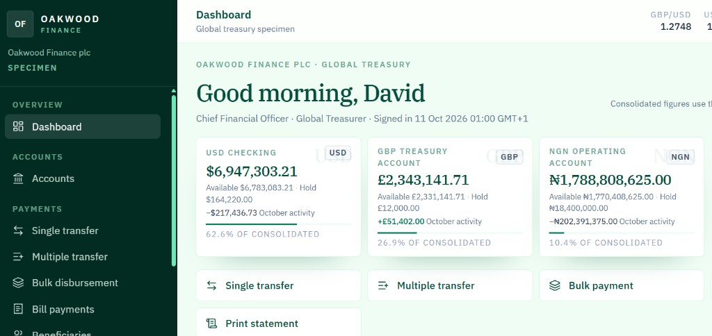
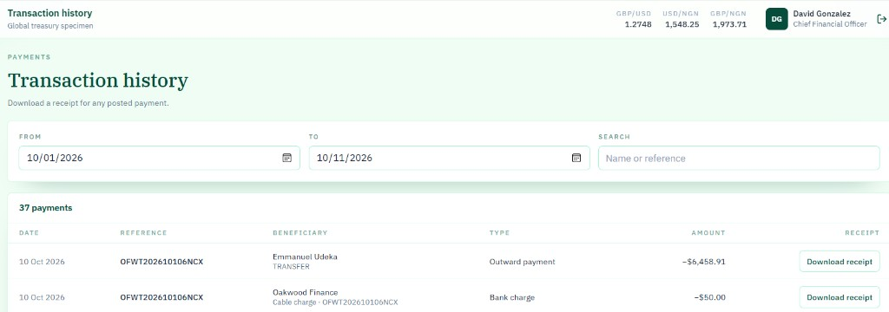

# Oakwood Finance

A specimen multi-currency treasury platform for Oakwood Finance. Authorize single, multiple, and bulk payments, pay bills, and download receipts from a client-side ledger in USD, GBP, and NGN. Nothing leaves the browser, and no payment is sent.

## Screenshots





## Run locally

```bash
npm install
npm run dev
```

Production build: `npm run build` (Netlify publish directory `dist`).

## Specimen mandates

| Mandate | Company ID | User ID | Password | PIN |
| --- | --- | --- | --- | --- |
| Chief Financial Officer / Global Treasurer | OAK-NY-4401 | DGONZALEZ | OakwoodCFO!26 | 482916 |
| Assistant Controller | OAK-NY-4401 | SSMITH | Control#8841 | 193847 |

The sign-in screen can prefill either mandate. **Reset demo data** restores the opening ledger.
